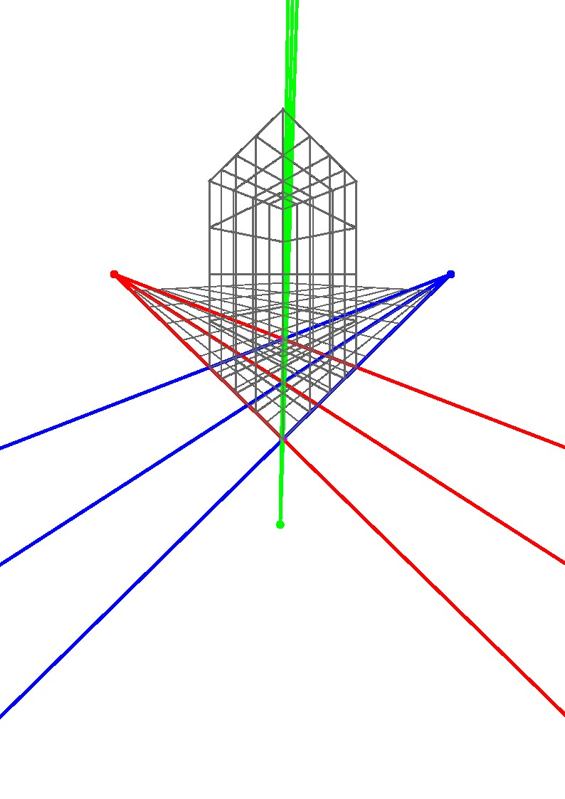
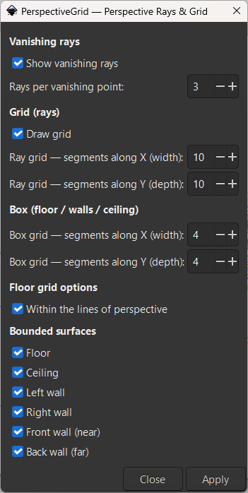

# PerspectiveGrid — Perspective Rays & Grid

[English](#english) | [Русский](#русский)

---

## 🇬🇧 English

An extension for **Inkscape 1.x** that constructs perspective rays (converging lines) and perspective grids based on markers placed on the canvas. It supports manual vanishing point placement as well as a **reverse-engineering mode** to reconstruct 3-point perspective from 4 corners of a flat surface.

<table>
  <tr>
    <td width="50%"></td>
    <td width="50%"></td>
  </tr>
  <tr>
    <td align="center"><i>Result: Perspective rays and 3D bounding box</i></td>
    <td align="center"><i>Plugin interface with flexible grid settings</i></td>
  </tr>
</table>

### Installation

1. Copy `perspective_grid_lines_v0_3.py` and `perspective_grid_lines_v0_3.inx` into your Inkscape extensions directory:
   - **Windows:** `%APPDATA%/inkscape/extensions/`
   - **Linux/macOS:** `~/.config/inkscape/extensions/`
2. Restart Inkscape.
3. Access the plugin via **Extensions → Custom → PerspectiveGrid — Perspective Rays**.

### Quick Start Template

The repository includes a ready-to-use template file: **`docs/perspective_grid_lines_v0_3.svg`**.  
Open it in Inkscape—it already contains pre-arranged marker sets for all supported modes (3, 5, 7 points, and reverse engineering). You can copy the desired marker set directly into your project instead of placing them manually.

### How It Works

The extension analyzes the **colors** of the selected markers and automatically determines the operating mode based on the color composition. Color is meaningful: it separates vanishing points from fan boundary limiters. Modes with **3, 5, and 7 markers** are supported.

---

### 3-Point Mode — Manual Vanishing Points

**When to use:** You already have an established perspective and know the exact locations of all three vanishing points.

**How to place markers:**
- Place **three objects of any color** (must be three distinct colors).
- **Two of them** must lie on the same horizontal line—these represent **VP1** (left) and **VP2** (right). Vertical (Y-axis) tolerance is 10 px.
- Place the **third object** strictly between them along the X-axis, either above or below the horizon line—this represents **VP3** (vertical vanishing point).

**Output:** Three fans of converging rays and the ability to generate a 3D box (floor, walls, ceiling).

---

### 5-Point Mode — Vanishing Points + 1 Pair of Limiters

**When to use:** You want to constrain the spread angles of the ray fans so the lines do not extend unnecessarily beyond your scene.

**How to place markers:**
- **Three objects of distinct colors** — Vanishing points VP1, VP2, and VP3 (arranged identically to the 3-point mode: 2 on the horizon + 1 between them along X).
- **Two objects of the same color** — Boundary limiters. They define the angular range within which rays for VP1 and VP2 are generated.
- **VP3** shares these same horizontal limiters, as there are no dedicated vertical limiters in this mode.

**Output:** Three bounded ray fans and surface grids.

---

### 7-Point Mode — Classic (2 Pairs of Limiters)

**When to use:** You need full, independent control over all three ray fans—separate limiters for the horizontal points and the vertical point.

**How to place markers:**
- **Three objects of distinct colors** — Vanishing points VP1, VP2, and VP3 (arranged as above).
- **A pair of Color A** (e.g., cyan) — Horizontal limiters. Define the angular range for VP1 and VP2.
- **A pair of Color B** (e.g., magenta) — Vertical limiters. Define the angular range for VP3.

**Output:** Three independent ray fans with customizable spread angles.

> ⚠️ If the vertical limiters (Pair B) are aligned strictly along the same vertical axis (identical X coordinate), they produce zero angular spread. In this case, the script automatically falls back to using the horizontal limiters for VP3 so the fan does not collapse into a single line.

---

### 7-Point Mode — Reverse Engineering

**When to use:** You have a photograph or reference image with an existing perspective and want to **reconstruct** the three vanishing points from the 4 corners of a flat plane (such as a building facade, floor, or wall).

**How to place markers:**
- **Four objects of the same color** — The four corners of a flat surface in perspective (e.g., the front face of a cube). Selection order does not matter; the script automatically sorts them by polar angle around their centroid.
- **Three objects of distinct colors** — The endpoints of three edges receding from the plane into the depth of the scene. Sorted by X coordinate: left edge → VP1, right edge → VP2, middle edge → VP3.

**How the script processes this:**
1. Calculates **VP1** and **VP2** from the four plane corners as the intersections of opposite sides of the quadrilateral (based on the theorem of vanishing points of parallel lines).
2. For **VP3**, evaluates all "3 out of 4" combinations of the plane corners, draws lines through each `(plane corner — edge endpoint)` pair, and finds the most consistent intersection point of the three lines.
3. Generates rays from each VP to the 4 plane corners (lower group) and to the 3 edge endpoints (upper group).

**Output:** Reconstructed vanishing points, horizon line, perspective rays, and an automatically calculated floor quadrilateral (`btm_quad`) for grid generation, allowing you to draw new elements accurately in the same perspective.

> 💡 This is a **reverse-engineering** mode—instead of defining the vanishing points yourself, you extract them from existing geometry.

---

### Output Layer Structure

The generated output is organized into three independent top-level groups (visible in the *Layers and Objects* panel) for easy visibility toggling:

**1. `Perspective_Rays`** — Converging perspective lines:
- **Horizon_Line_Group** — The horizon line passing through VP1 and VP2.
- **Vanishing_Points_Markers** — Colored dots placed at the calculated VP coordinates (Reverse Engineering mode only).
- **Floor_Rays_VP1 / VP2 / VP3** — Rays directed toward the 4 corners of the flat plane (floor).
- **Ceiling_Rays_VP1 / VP2 / VP3** — Rays directed toward the 3 receding edge endpoints (top).

**2. `Perspective_Grid`** — Fan-based perspective grids:
- **Grid_WithinPerspective** — Grid constrained inside the perspective triangle (hairline stroke).
- **Grid_ToTheEdgeOfPage** — Grid extended to the edges of the document page.

**3. `Perspective_Box`** — Bounded surfaces (3D Box):
- **Grid_Floor**, **Grid_Ceiling**, **Grid_LeftWall**, **Grid_RightWall**, **Grid_FrontWall**, **Grid_BackWall** — Homography-projected surface grids (hairline stroke).  
  *Layers are ordered by z-index: floor at the bottom, ceiling at the top, ensuring walls do not overlap improperly.*

---

### Dialog Parameters

The extension dialog is divided into logical sections for fine-tuning:

| Parameter | Description |
| :--- | :--- |
| **Show vanishing rays** | Toggle generation of the converging perspective rays on/off. |
| **Rays per vanishing point** | From `1` to `50`. Controls the density of rays per fan. |
| **Draw grid** | Toggle generation of perspective grids on/off. |
| **Ray grid — segments along X/Y** | Grid subdivision density for fan grids (*Within the lines* / *To the edge*). |
| **Box grid — segments along X/Y** | Grid subdivision density for the 3D box (floor, walls, ceiling). Allows finer tiling on surfaces independent of ray density. |
| **Within the lines of perspective** | Draws a grid inside the perspective triangle. In reverse-engineering mode, automatically maps onto the floor plane. |
| **Bounded surfaces** | Checkboxes to toggle individual faces of the 3D box (floor, ceiling, left/right/front/back walls). |

---

### Limitations & Notes

- All markers must be separate objects with a non-zero Bounding Box (circles, ellipses, stars, text, or any shape).
- Marker color is read from the `stroke` attribute; if no stroke is present, it falls back to `fill`.
- The plugin does not modify your original markers; it only creates new layer groups. Running the extension again overwrites the previously generated groups rather than creating duplicates.
- In Reverse Engineering mode, the 4 plane markers must form a **convex** quadrilateral.

---
---

## 🇷🇺 Русский

Расширение для **Inkscape 1.x**, которое строит линии схождения (perspective rays) и перспективные сетки (grid) по маркерам, расставленным на холсте. Поддерживает ручное задание точек схода и режим **обратного инжиниринга** для восстановления перспективы по 4 точкам плоской грани.

<table>
  <tr>
    <td width="50%"></td>
    <td width="50%"></td>
  </tr>
  <tr>
    <td align="center"><i>Результат: лучи схождения и 3D-коробка</i></td>
    <td align="center"><i>Интерфейс плагина с гибкой настройкой сеток</i></td>
  </tr>
</table>

### Установка

1. Скопируйте `perspective_grid_lines_v0_3.py` и `perspective_grid_lines_v0_3.inx` в папку расширений Inkscape:
   - **Windows:** `%APPDATA%/inkscape/extensions/`
   - **Linux/macOS:** `~/.config/inkscape/extensions/`
2. Перезапустите Inkscape.
3. Плагин появится в меню **Расширения → Custom → PerspectiveGrid — Perspective Rays**.

### Шаблон для быстрого старта

В репозитории также лежит файл **`docs/perspective_grid_lines_v0_3.svg`**.  
Откройте его в Inkscape — на холсте уже расставлены маркеры для всех поддерживаемых режимов (3, 5, 7 точек и обратный инжиниринг). Вы можете копировать нужный набор маркеров в свой проект, чтобы не расставлять их вручную.

### Как это работает

Расширение анализирует **цвета** выделенных маркеров и по составу цветов автоматически определяет режим. Цвет имеет смысл: он отделяет точки схода от ограничителей веера. Поддерживается **3, 5 и 7 маркеров**.

---

### Режим 3 точек — ручные точки схода

**Когда использовать:** у вас уже есть готовая перспектива и вы знаете, где находятся все три точки схода.

**Как расставить маркеры:**
- Поставьте **три объекта любого цвета** (обязательно разных цветов).
- **Два из них** должны лежать на одной горизонтальной линии — это **VP1** (левая) и **VP2** (правая). Допуск по Y — 10 px.
- **Третий объект** поставьте строго между ними по оси X, но выше или ниже линии горизонта — это **VP3** (вертикальная точка схода).

**Что получите:** три веера лучей и возможность построить 3D-коробку (пол, стены, потолок).

---

### Режим 5 точек — точки схода + пара ограничителей

**Когда использовать:** вы хотите ограничить углы раскрытия вееров, чтобы лучи не уходили в пустоту за пределы сцены.

**Как расставить маркеры:**
- **Три объекта разных цветов** — это точки схода VP1, VP2, VP3. Расстановка такая же, как в режиме 3 точек (2 на горизонте + 1 между ними по X).
- **Два объекта одного цвета** — это ограничители. Они задают, в каком диапазоне углов строятся лучи VP1 и VP2.
- Для **VP3** используются те же горизонтальные ограничители, так как вертикальных ограничителей в этом режиме нет.

**Что получите:** три ограниченных веера лучей и сетки поверхностей.

---

### Режим 7 точек — классический (2 пары ограничителей)

**Когда использовать:** нужен полный контроль над всеми тремя веерами — отдельные ограничители для горизонтальных и для вертикального.

**Как расставить маркеры:**
- **Три объекта разных цветов** — точки схода VP1, VP2, VP3 (расстановка как выше).
- **Пара цвета A** (например, голубые) — горизонтальные ограничители. Задают диапазон для VP1 и VP2.
- **Пара цвета B** (например, малиновые) — вертикальные ограничители. Задают диапазон для VP3.

**Что получите:** три независимых веера с настраиваемой шириной каждого.

> ⚠️ Если вертикальные ограничители (пара B) стоят строго на одной вертикальной оси (одинаковый X), они не дают углового раскрытия. В этом случае скрипт автоматически использует горизонтальные ограничители для VP3, чтобы веер не схлопнулся в одну линию.

---

### Режим 7 точек — обратный инжиниринг

**Когда использовать:** у вас есть фотография или референс с уже нарисованной перспективой, и вы хотите **восстановить** три точки схода по 4 углам какой-либо плоской грани (например, фасада, пола или стены).

**Как расставить маркеры:**
- **Четыре объекта одного цвета** — это четыре угла плоской грани объекта в перспективе. Порядок не важен, скрипт сам упорядочит их по полярному углу вокруг центра масс. Пример: передняя грань куба.
- **Три объекта разных цветов** — это три ребра, уходящие от грани вглубь сцены. Отсортируются по X: левое ребро → VP1, правое → VP2, центральное → VP3.

**Что делает скрипт:**
1. По четырём точкам грани вычисляет VP1 и VP2 — как пересечения противоположных сторон четырёхугольника (теорема о точках схода параллельных прямых).
2. Для VP3 перебирает все комбинации «3 из 4» точек грани, проводит через каждую пару (угол грани — конец ребра) прямую и ищет наиболее согласованное пересечение всех трёх прямых. Так получается третья точка схода.
3. Строит лучи от каждой VP к 4 углам грани (нижняя группа) и к 3 концам рёбер (верхняя группа).

**Что получите:** реконструированные точки схода, линию горизонта, лучи и автоматически рассчитанный четырехугольник пола (`btm_quad`) для построения сетки. По ним можно достраивать новые элементы в той же перспективе.

> 💡 Это режим **обратного инжиниринга** — вы не задаёте точки схода, а получаете их как результат анализа геометрии.

---

### Структура результата

Результат работы плагина разделен на три независимые группы верхнего уровня (в панели «Объекты и слои»), что позволяет гибко управлять видимостью:

**1. `Perspective_Rays`** — лучи схождения:
- **Horizon_Line_Group** — линия горизонта через VP1 и VP2.
- **Vanishing_Points_Markers** — цветные точки в вычисленных позициях VP (только для режима обратного инжиниринга).
- **Floor_Rays_VP1 / VP2 / VP3** — лучи к 4 углам плоской грани (пол).
- **Ceiling_Rays_VP1 / VP2 / VP3** — лучи к 3 концам рёбер (верх).

**2. `Perspective_Grid`** — сетки от лучей (веерные):
- **Grid_WithinPerspective** — сетка внутри треугольника перспективы (hairline).
- **Grid_ToTheEdgeOfPage** — сетка до краев страницы.

**3. `Perspective_Box`** — ограниченные поверхности (3D-коробка):
- **Grid_Floor**, **Grid_Ceiling**, **Grid_LeftWall**, **Grid_RightWall**, **Grid_FrontWall**, **Grid_BackWall** — сетки на гранях (гомография, hairline).  
  *Слои упорядочены по z-index: пол внизу, потолок сверху, стены не перекрывают друг друга некорректно.*

---

### Параметры в диалоге

Интерфейс разделен на логические блоки для тонкой настройки:

| Параметр | Значение |
| :--- | :--- |
| **Show vanishing rays** | Вкл/выкл — строить ли сами лучи. |
| **Rays per vanishing point** | От 1 до 50. Плотность лучей. |
| **Draw grid** | Вкл/выкл — строить ли сетки. |
| **Ray grid — segments along X/Y** | Плотность сетки для веерных лучей (Within the lines / To the edge). |
| **Box grid — segments along X/Y** | Плотность сетки для 3D-коробки (пол, стены, потолок). Позволяет делать плитку на полу чаще, чем разметку лучей. |
| **Within the lines of perspective** | Строит сетку внутри треугольника перспективы. В режиме reverse-инжиниринга автоматически ложится на пол. |
| **Bounded surfaces** | Чекбоксы для отрисовки 3D-коробки (пол, потолок, стены). |

---

### Ограничения

- Все маркеры должны быть отдельными объектами с ненулевым Bounding Box (круги, эллипсы, звёзды, текст — любой формы).
- Цвет берётся из атрибута `stroke`; если обводки нет — из `fill`.
- Плагин не модифицирует исходные маркеры, только создаёт новые группы. Повторный запуск перезаписывает группы, не копит дубликаты.
- В режиме обратного инжиниринга 4 точки грани должны образовывать **выпуклый** четырёхугольник.

---

## License / Лицензия

**GPL-3.0-or-later**

This program is free software: you can redistribute it and/or modify it under the terms of the GNU General Public License as published by the Free Software Foundation, either version 3 of the License, or (at your option) any later version.

Эта программа распространяется на условиях GNU General Public License версии 3 или (по вашему выбору) любой более поздней версии.