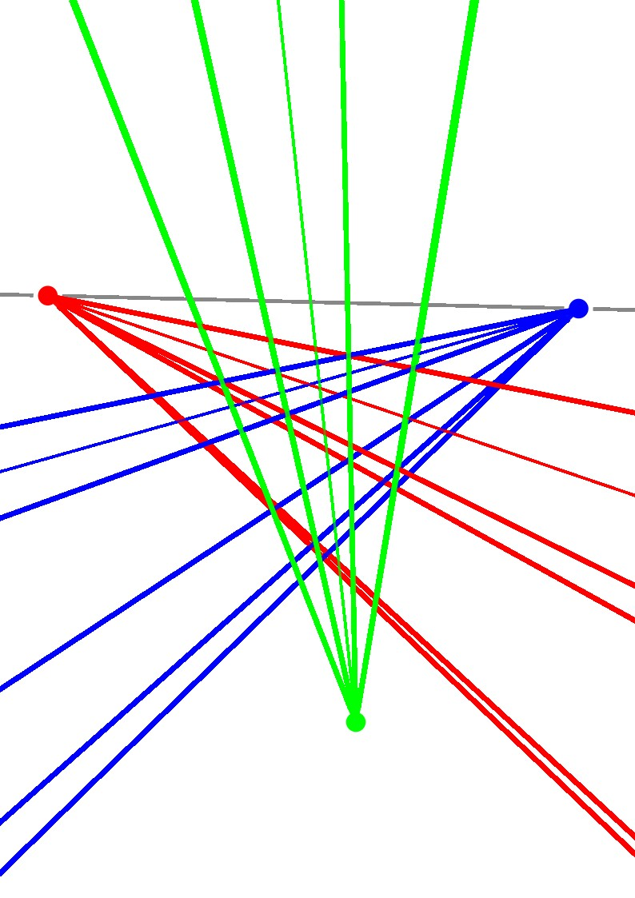

# PerspectiveGrid — Perspective Rays

Расширение для Inkscape 1.x, которое строит линии схождения (perspective rays) 
по маркерам, расставленным на холсте. Поддерживает ручное задание точек схода 
и режим обратного инжиниринга для восстановления перспективы по 4 точкам 
плоской грани.

## Установка

1. Скопируйте `perspective_grid_lines_v0_3.py` и `perspective_grid_lines_v0_3.inx`
   в папку расширений Inkscape:
   - **Windows:** `%APPDATA%/inkscape/extensions/`
   - **Linux/macOS:** `~/.config/inkscape/extensions/`
2. Перезапустите Inkscape.
3. Плагин появится в меню **Расширения → Custom → PerspectiveGrid — Perspective Rays**.

## Шаблон для быстрого старта

В репозитории также лежит файл **`perspective_grid_lines_v0_3.svg`**. 
Откройте его в Inkscape — на холсте уже расставлены маркеры для всех 
поддерживаемых режимов (3, 5, 7 точек и обратный инжиниринг). 
Вы можете копировать нужный набор маркеров в свой проект, чтобы не 
расставлять их вручную.

## Как это работает

Расширение анализирует **цвета** выделенных маркеров и по составу цветов 
автоматически определяет режим. Цвет имеет смысл: он отделяет точки схода 
от ограничителей веера. Поддерживается 3, 5 и 7 маркеров.

---

## Режим 3 точек — ручные точки схода

**Когда использовать:** у вас уже есть готовая перспектива и вы знаете, 
где находятся все три точки схода.

**Как расставить маркеры:**
- Поставьте **три объекта любого цвета** (обязательно разных цветов).
- **Два из них** должны лежать на одной горизонтальной линии — это **VP1** (левая) 
  и **VP2** (правая). Допуск по Y — 10 px.
- **Третий объект** поставьте строго между ними по оси X, но выше или ниже 
  линии горизонта — это **VP3** (вертикальная точка схода).

**Что получите:** три веера лучей, каждый построен между направлениями 
на две другие точки схода.

---

## Режим 5 точек — точки схода + пара ограничителей

**Когда использовать:** вы хотите ограничить углы раскрытия вееров, 
чтобы лучи не уходили в пустоту за пределы сцены.

**Как расставить маркеры:**
- **Три объекта разных цветов** — это точки схода VP1, VP2, VP3. 
  Расстановка такая же, как в режиме 3 точек (2 на горизонте + 1 между ними по X).
- **Два объекта одного цвета** — это ограничители. Они задают, 
  в каком диапазоне углов строятся лучи VP1 и VP2.
- Для **VP3** используются те же горизонтальные ограничители, 
  так как вертикальных ограничителей в этом режиме нет.

**Что получите:** три ограниченных веера лучей вместо трёх бесконечных.

---

## Режим 7 точек — классический (2 пары ограничителей)

**Когда использовать:** нужен полный контроль над всеми тремя веерами — 
отдельные ограничители для горизонтальных и для вертикального.

**Как расставить маркеры:**
- **Три объекта разных цветов** — точки схода VP1, VP2, VP3 
  (расстановка как выше).
- **Пара цвета A** (например, голубые) — горизонтальные ограничители. 
  Задают диапазон для VP1 и VP2.
- **Пара цвета B** (например, малиновые) — вертикальные ограничители. 
  Задают диапазон для VP3.

**Что получите:** три независимых веера с настраиваемой шириной каждого.

> ⚠️ Если вертикальные ограничители (пара B) стоят строго на одной 
> вертикальной оси (одинаковый X), они не дают углового раскрытия. 
> В этом случае скрипт автоматически использует горизонтальные ограничители 
> для VP3, чтобы веер не схлопнулся в одну линию.

---

## Режим 7 точек — обратный инжиниринг

**Когда использовать:** у вас есть фотография или референс с уже 
нарисованной перспективой, и вы хотите **восстановить** три точки схода 
по 4 углам какой-либо плоской грани (например, фасада, пола или стены).

**Как расставить маркеры:**
- **Четыре объекта одного цвета** — это четыре угла плоской грани 
  объекта в перспективе. Порядок не важен, скрипт сам упорядочит их 
  по полярному углу вокруг центра масс. Пример: передняя грань куба.
- **Три объекта разных цветов** — это три ребра, уходящие от грани 
  вглубь сцены. Отсортируются по X: левое ребро → VP1, правое → VP2, 
  центральное → VP3.

**Что делает скрипт:**
1. По четырём точкам грани вычисляет VP1 и VP2 — как пересечения 
   противоположных сторон четырёхугольника (теорема о точках схода 
   параллельных прямых).
2. Для VP3 перебирает все комбинации «3 из 4» точек грани, проводит 
   через каждую пару (угол грани — конец ребра) прямую и ищет 
   наиболее согласованное пересечение всех трёх прямых. 
   Так получается третья точка схода.
3. Строит лучи от каждой VP к 4 углам грани (нижняя группа) 
   и к 3 концам рёбер (верхняя группа).

**Что получите:** реконструированные точки схода, линию горизонта 
и лучи, которые визуально совпадают с реальными рёбрами исходного 
объекта. По ним можно достраивать новые элементы в той же перспективе.

> 💡 Это режим **обратного инжиниринга** — вы не задаёте точки схода, 
> а получаете их как результат анализа геометрии.

---

## Структура результата

Все лучи попадают в одну группу `Perspective_Rays`, внутри которой 
создаются подгруппы с осмысленными названиями:

- **Horizon_Line_Group** — линия горизонта через VP1 и VP2.
- **Vanishing_Points_Markers** — цветные точки в вычисленных позициях VP 
  (только для режима обратного инжиниринга, чтобы вы могли визуально 
  проверить корректность).
- **Floor_Rays_VP1 / VP2 / VP3** — лучи к 4 углам плоской грани (пол).
- **Ceiling_Rays_VP1 / VP2 / VP3** — лучи к 3 концам рёбер (верх).
- **Rays_VP1 / VP2 / VP3** — основные лучи для режимов 3/5/7 классических.

Каждую подгруппу можно скрыть, удалить или перекрасить независимо 
в панели **Объекты и слои** — это удобно, если вы работаете только 
с полом или только с потолком.

---

## Параметры в диалоге

| Параметр | Значение |
|---|---|
| **Лучи схождения** | Вкл/выкл — строить ли лучи вообще |
| **Количество лучей от каждой точки схода** | От 1 до 50. В режимах 3/5/7 задаёт плотность веера. В обратном инжиниринге — минимальное число лучей к 4 точкам грани всегда 4, а параметр добавляет промежуточные для плотности |

---

## Ограничения

- Все маркеры должны быть отдельными объектами с ненулевым Bounding Box 
  (круги, эллипсы, звёзды, текст — любой формы).
- Цвет берётся из атрибута `stroke`; если обводки нет — из `fill`.
- Плагин не модифицирует исходные маркеры, только создаёт новую группу 
  `Perspective_Rays`. Повторный запуск перезаписывает группу, не копит дубликаты.
- В режиме обратного инжиниринга 4 точки грани должны образовывать 
  **выпуклый** четырёхугольник, иначе противоположные стороны могут 
  не пересечься (или пересекутся в «неправильной» точке).

---

## License / Лицензия

GPL-3.0-or-later

This program is free software: you can redistribute it and/or modify it under the terms of the GNU General Public License as published by the Free Software Foundation, either version 3 of the License, or (at your option) any later version.

Эта программа распространяется на условиях GNU General Public License версии 3 или (по вашему выбору) любой более поздней версии.
